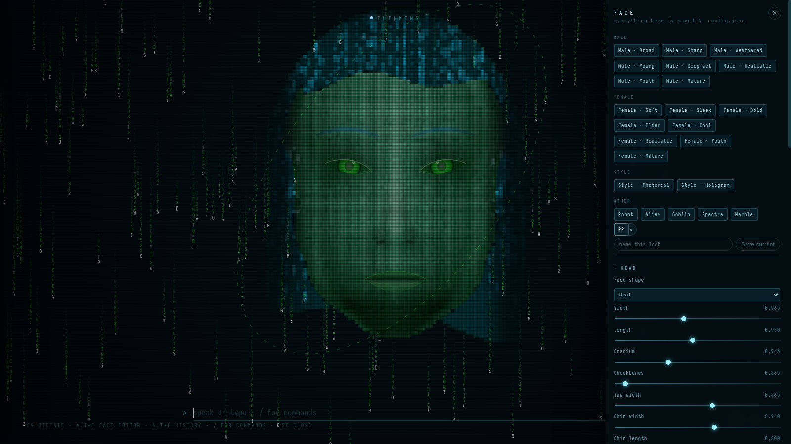
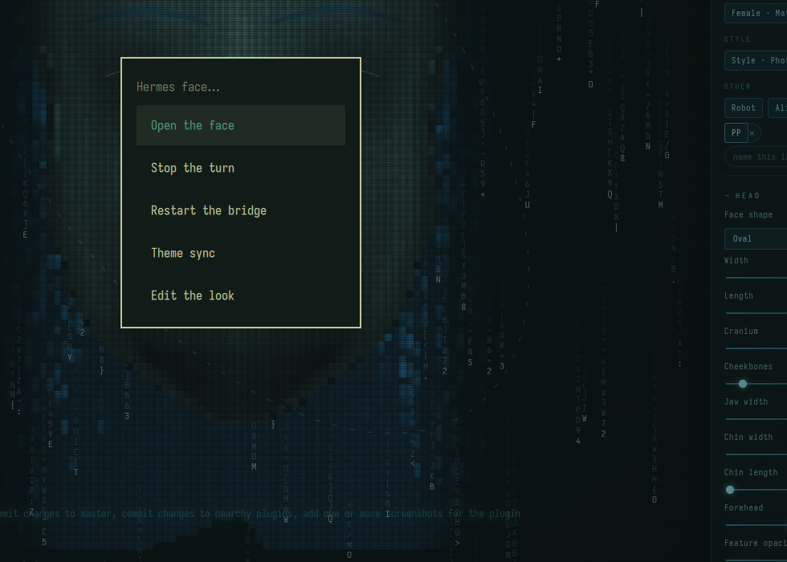

# Hermes Face — a face for your agent, on your bar


<p align="center">
  
  
</p>

**What is an AI without a face?** This one has it: a holographic head that lives as a single glyph
on your bar — idle, thinking, speaking or failed — and answers in your own agent's voice. The face
ships inside this repository, so one install is the whole thing; nothing is fetched from another
project at install time.

```
○  idle        ◐  thinking        ◉  speaking        ✕  failed or not running
```

- **Left click** — start the face if it is not running, then go to workspace 1 and bring its
  window forward.
- **Right click** — open the Hermes menu: open the face, stop the turn, restart the bridge, theme sync, edit the look. Everything a touchpad can reach.
- **Middle click** — restart the face bridge and wait until it answers again.

The tooltip carries the current state, the mood while it speaks, an error if the bridge
reported one, and whether theme sync is on.

## Requirements

- **Omarchy 4** with the Quickshell bar (this is a bar widget, not a window app).
- **A Hermes agent** — the face is a head bolted onto your own agent, so `hermes` must be on
  `PATH` (or `HERMES_BIN` set) and able to run `hermes chat --query-file`. It must be installed
  separately; this plugin does not download or install it, and that is why the marketplace marks
  the listing as manual setup.
- **A browser** — any Chromium-family browser (chromium, brave, vivaldi, chrome, edge) for the
  locked-down app window, or Firefox/LibreWolf as a fallback with a plain window.
- `python3` for the bridge, `curl` and `hyprctl` for the bar scripts, and optionally `edge-tts`
  for voice; without it the face displays silently.

If the agent is missing the bar shows ✕ and the tooltip says so instead of pretending to be idle,
and a turn answers "I have no Hermes agent to think with" rather than failing silently. An agent
too old to take `--query-file` is refused rather than fed your words on the command line, where
`ps` would show them; `HERMES_FACE_ALLOW_INLINE_PROMPT=1` opts into that trade knowingly.

## What gets installed, and where

Nothing outside your home directory, no root, no credentials:

- `~/.local/share/hermes-face/` — the face: `server.py`, the `web/` renderer, your `config.json`
  (seeded from `config.example.json` on first run, never overwritten afterwards), the audio it
  speaks, and a private `.venv` if one is needed.
- `~/.config/systemd/user/hermes-face.service` — created on the first click so the bridge
  survives a logout and the bar can restart it. Not created if the unit already exists.
- `~/.cache/hermes-face-bar.log` — one line per click, restart and theme sync.

The only third-party dependency is the speech engine, `edge-tts`, which is installed into that
private `.venv` from PyPI if no working copy is already present. The face runs without it; it
just stays silent, and says so on screen.

That engine is not local: it synthesises through Microsoft's Edge read-aloud service, so the
sentence being spoken leaves the machine. Nothing else does — no audio, no microphone input, no
history. See `SECURITY.md` for the full list of what runs, what it may open, and how the bridge is
gated.

## Install

```bash
omarchy plugin add https://github.com/Xarrathh/omarchy-hermes-face.git --enable
omarchy restart shell          # a new bar widget is not instantiated until the shell restarts
```

Or by hand: copy this folder to `~/.config/omarchy/plugins/pierregoosen.hermes-face/`, add
`{"id": "pierregoosen.hermes-face"}` to a `bar.layout` section in `~/.config/omarchy/shell.json`,
then `omarchy restart shell`.

The first left click installs and starts the face and opens it. After that the click is instant.

## Updating

```bash
omarchy plugin update pierregoosen.hermes-face
```

Then **middle-click the bar icon** (or run `bin/face-restart.sh`). That action syncs the vendored
`face/` into `~/.local/share/hermes-face/` *first* and restarts the bridge afterwards, so the code
that runs is the code you just installed. A left click does the same sync when it notices the
vendored version has changed, but it will not interrupt a live turn on an unchanged install.

Your `config.json` (your tuned face) and `history.json` (your conversations) are never copied over.

## Remove

```bash
omarchy plugin remove pierregoosen.hermes-face     # the widget
systemctl --user disable --now hermes-face        # the bridge, if you want it stopped
rm -rf ~/.local/share/hermes-face                 # the face, its config and your history
rm -f ~/.config/systemd/user/hermes-face.service
```

Your `config.json` holds your tuned face and `history.json` your conversations — deleting the
prefix deletes both, so move them aside first if you want to keep them.

## Face to face

Two faces on the same network can hold a conversation, and each speaks with its own voice: the
wire carries text for turn-taking and the mp3 for the answer, never a microphone. It is **opt-in**
because it opens a port:

```bash
bin/face-peer-enable.sh              # install, start, print the firewall rule
bin/face-peer-enable.sh --firewall   # also apply an nftables rule limited to your LAN subnet
```

That writes `face-peer.service`, creates a shared key at `~/.local/share/hermes-face/peer.key`
(mode `0600`) and prints it — copy that key to the other face, because every peer endpoint refuses
a request without it. `/health` stays open; `/ask`, `/speak`, `/talk` and `/peers` do not.

`--firewall` adds one LAN-scoped rule with whatever is actually running — `ufw`, `firewalld`, or an
`inet filter` table — and records that it did, so the installer can apply it once and never ask
again. It writes the rule to `~/.local/share/hermes-face/peer-firewall.nft` either way, and if no
firewall is running it says so plainly rather than pretending the port is closed.

## Included extras

These are installed for you on the first start — no copying files, no editing anything by hand.
They run once, and if you remove one deliberately it stays removed.

- The global stop key, `hermes-face-stop`, which interrupts the live turn and silences the voice
  and does nothing when there is no turn. A first start puts it in `~/.local/bin` and appends one
  line to `~/.config/hypr/bindings.lua` — `SUPER + SHIFT + H` — leaving a backup of that file
  beside it as `bindings.lua.hermes-face.bak`. Delete the line to drop the key.
- The theme hook, `hooks/theme-set.d/hermes-face-theme.hook`, which pulls the face's hues toward
  the active theme and never touches the geometry. It keeps doing that after you pick colours by
  hand, so the theme can still move them; `hermes-face-theme-sync off` (or the menu's Theme sync
  entry) is the real opt-out, and `on` gives the hues back to the theme.

## Notes

- The glyph is a single character on purpose: Omarchy's `BarIconButton` renders one optical
  glyph in a fixed slot, so anything longer is clipped.
- `bin/*.sh` resolve Hyprland's socket name themselves. A bar-launched process can arrive
  without `HYPRLAND_INSTANCE_SIGNATURE`, and `hyprctl` then fails silently with exit 0.
- On this Hyprland, `hyprctl dispatch workspace 1` is a parse error and the comma form is
  ignored; the only form that switches workspace is
  `hyprctl dispatch 'hl.dsp.focus({ workspace = "1" })'`.

## Licence

MIT — see `LICENSE`.
