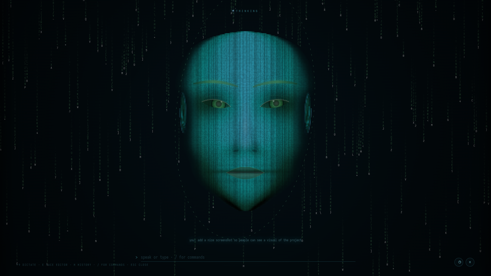

# Hermes Face — Omarchy bar widget and agent head



A bar slot and a holographic agent head: one glyph that tells you what the face is doing, with
the controls you actually reach for. The face itself ships inside this repository, so installing
the plugin gives you a working system — nothing is fetched from another project at install time.

```
○  idle        ◐  thinking        ◉  speaking        ✕  failed or not running
```

- **Left click** — start the face if it is not running, then go to workspace 1 and bring its
  window forward.
- **Right click** — stop the live turn and its speech.
- **Middle click** — restart the face bridge and wait until it answers again.

The tooltip carries the current state, the mood while it speaks, an error if the bridge
reported one, and whether theme sync is on.

## What gets installed, and where

Nothing outside your home directory, no root, no credentials:

- `~/.local/share/hermes-face/` — the face: `server.py`, the `web/` renderer, your `config.json`
  (seeded from `config.example.json` on first run, never overwritten afterwards), the audio it
  speaks, and a private `.venv` if one is needed.
- `~/.config/systemd/user/hermes-face.service` — created on the first click so the bridge
  survives a logout and the bar can restart it. Not created if the unit already exists.
- `~/.cache/hermes-face-bar.log` — one line per click, restart and theme sync.

The only third-party dependency is the speech engine, `edge-tts`, which is installed into that
private `.venv` from PyPI if no working copy is already present. The face runs without it; it
just stays silent, and says so on screen.

That engine is not local: it synthesises through Microsoft's Edge read-aloud service, so the
sentence being spoken leaves the machine. Nothing else does — no audio, no microphone input, no
history. See `SECURITY.md` for the full list of what runs, what it may open, and how the bridge is
gated.

## Install

```bash
omarchy plugin add https://github.com/Xarrathh/omarchy-hermes-face.git --enable
omarchy restart shell          # a new bar widget is not instantiated until the shell restarts
```

Or by hand: copy this folder to `~/.config/omarchy/plugins/pierregoosen.hermes-face/`, add
`{"id": "pierregoosen.hermes-face"}` to a `bar.layout` section in `~/.config/omarchy/shell.json`,
then `omarchy restart shell`.

The first left click installs and starts the face and opens it. After that the click is instant.

## Updating

```bash
omarchy plugin update pierregoosen.hermes-face
```

Then **middle-click the bar icon** (or run `bin/face-restart.sh`). That action syncs the vendored
`face/` into `~/.local/share/hermes-face/` *first* and restarts the bridge afterwards, so the code
that runs is the code you just installed. A left click does the same sync when it notices the
vendored version has changed, but it will not interrupt a live turn on an unchanged install.

Your `config.json` (your tuned face) and `history.json` (your conversations) are never copied over.

## Remove

```bash
omarchy plugin remove pierregoosen.hermes-face     # the widget
systemctl --user disable --now hermes-face        # the bridge, if you want it stopped
rm -rf ~/.local/share/hermes-face                 # the face, its config and your history
rm -f ~/.config/systemd/user/hermes-face.service
```

Your `config.json` holds your tuned face and `history.json` your conversations — deleting the
prefix deletes both, so move them aside first if you want to keep them.

## Requirements

Any Chromium-family browser (chromium, brave, vivaldi, chrome, edge) for the locked-down app
window, or Firefox/LibreWolf as a fallback with a plain window. `python3` for the bridge.
`curl` and `hyprctl` are used by the bar scripts.

## Optional extras

`bin/hermes-face-stop` is the global stop key — it interrupts the live turn and silences the
voice, and refuses when nothing is running:

```bash
install -Dm755 bin/hermes-face-stop ~/.local/bin/hermes-face-stop
# then, in ~/.config/hypr/bindings.lua:
#   o.bind("SUPER + SHIFT + H", "Stop Hermes face", "hermes-face-stop")
```

`hooks/theme-set.d/hermes-face-theme.hook` pulls the face's colours toward the active theme —
hue and saturation only, never the geometry — and switches itself off the moment you pick
colours by hand. Install it with:

```bash
mkdir -p ~/.config/omarchy/hooks/theme-set.d
cp hooks/theme-set.d/hermes-face-theme.hook ~/.config/omarchy/hooks/theme-set.d/
install -Dm755 bin/hermes-face-theme-sync ~/.local/bin/hermes-face-theme-sync
hermes-face-theme-sync on      # or: off
```

## Notes

- The glyph is a single character on purpose: Omarchy's `BarIconButton` renders one optical
  glyph in a fixed slot, so anything longer is clipped.
- `bin/*.sh` resolve Hyprland's socket name themselves. A bar-launched process can arrive
  without `HYPRLAND_INSTANCE_SIGNATURE`, and `hyprctl` then fails silently with exit 0.
- On this Hyprland, `hyprctl dispatch workspace 1` is a parse error and the comma form is
  ignored; the only form that switches workspace is
  `hyprctl dispatch 'hl.dsp.focus({ workspace = "1" })'`.

## Licence

MIT — see `LICENSE`.
